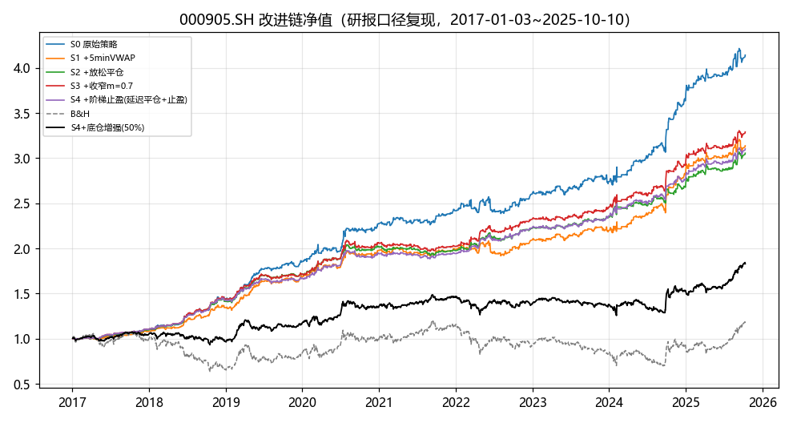
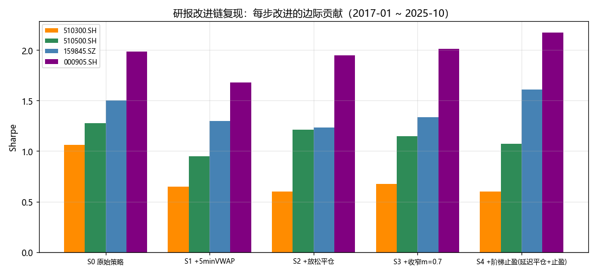
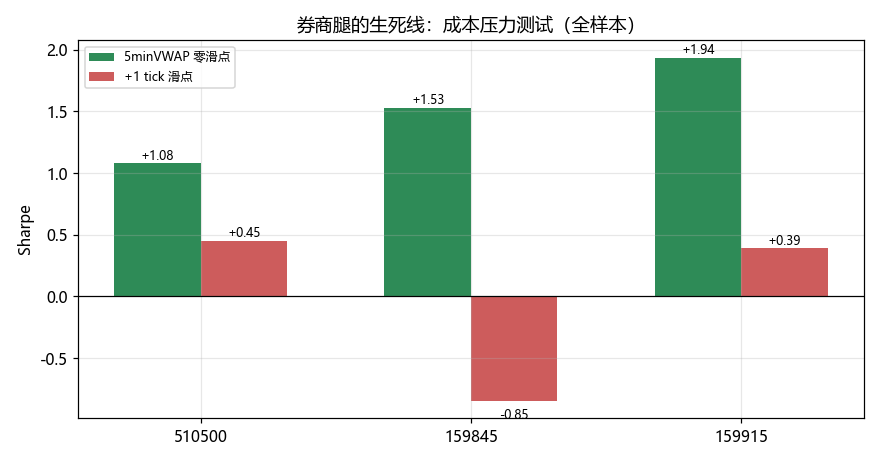
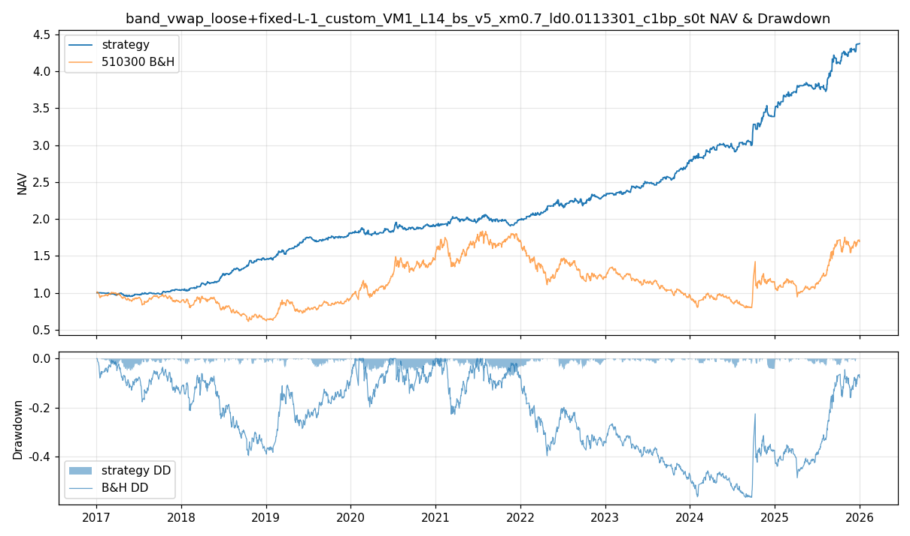
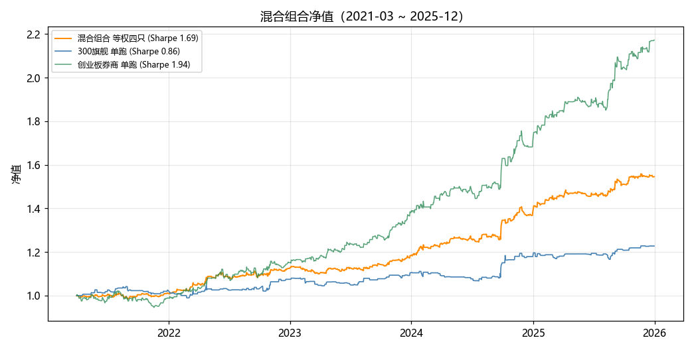

# 研究之路（二）：券商改良策略接入——从"结论冲突"到"安全并入"

> 旗舰策略定型后，一份券商研报摆上桌：同样的噪声带策略，他们的两个"改进"效果显著——
> 而我们的结论恰好相反：那两个改进在 A 股全是负贡献。
> 本报告记录我们如何查清"谁对"，又如何把券商的改进安全地接进自己的体系。

---

## 第 1 步：冲突摆上台面——同策略、反结论

2024 年 8 月的券商研报（新浪转载）与我们的旗舰研究，对同一策略给出相反判断：

| 改进 | 券商研报（中证500指数，2013-2024) | 我们的结论（510300,2017-2025) |
|---|---|---|
| 紧止损（当前带+VWAP) | Sharpe 2.11→**2.63**,MDD 减半 | Sharpe 0.269→**−0.244**，失效 |
| 波动目标动态仓位 | 年化 26.8%→**42.3%** | 总收益 −58%，严重失效 |
| 1 小时三时点入场 | 采用（10:29/11:29/13:59) | 采用（且证实有效） |

两个团队测的是"同一个策略"，结论却相反。**谁对？还是都对？**

## 第 2 步：先别争对错，把口径拆成原子

我们把双方的全部口径差异列出来，一共六个原子差异：

| # | 差异点 | 券商研报 | 我们此前 |
|---|---|---|---|
| 1 | 标的层级 | **指数**（信号级） | ETF（可交易级） |
| 2 | 样本期 | 2013-01 ~ 2024-07（含 2015 股灾趋势日） | 2017-01 ~ 2025-12 |
| 3 | 重入规则 | **带外即入**（决策点价格在带外即可） | 新跨越（armed，止损后不原地再入） |
| 4 | 滑点 | **零滑点**（仅万1佣金） | 万1 + 1 tick 滑点 |
| 5 | 止损频率 | 每分钟 | 决策时点 |
| 6 | 决策网格 | 1 小时三时点 | 半小时网格 |

**实验设计**：固定其他条件，逐项消融，定位"改进失效"的主因。

## 第 3 步：消融实验——改进在指数层级真的成立

按研报精确口径（h3 + 分钟止损 + 带外即入 + 零滑点），在 6 个对象（3 指数 + 3 ETF）上重测改进链：

- **中证500指数**：初始 1.875 → 紧止损改进 **2.547** → 加杠杆 **2.672**——**改进成立，与研报方向一致**;
- 沪深300 指数：1.150 → 1.825（成立）;
- 510300/510500 ETF：改进方向同样成立，但幅度打折。

归因分解（510300，研报对齐段）:

| 因子 | 对 Sharpe 的影响 | 说明 |
|---|---|---|
| **滑点 1 tick** | **−0.4 ~ −1.6（最大元凶）** | 单笔边际利润 ~10bps,1 tick≈2-3bps/边 |
| 重入规则（带外即入） | +0.1~+0.3 | 紧止损后价格常在带外，带外即入能重新上车 |
| 标的层级（指数→ETF) | −0.1~−0.4 | ETF 的竞价/折溢价噪声 |
| 样本期（缺 2013-2015) | 量级差 | 只影响数值高低，不改方向 |

**那一刻想通的结论**：两边都对——研报的改进在"指数+零滑点"的世界里成立；
我们的失效结论是在"ETF+真实成本+新跨越+半小时网格"的世界里成立。
**改进能不能接，取决于执行成本，而不是逻辑。**

## 第 4 步：新情报——券商自己也在迭代（2.0 版三个改进）

2025-12 西部证券《确定趋势：ETF 日内动量策略》针对初版的三个问题给出新改进（图 1):

1. **执行**：信号后 **5 分钟 VWAP/TWAP** 成交（次分钟开盘价"较难实现");
2. **平仓过早 → 延迟平仓**：止损方向翻转（多 min(UB,VWAP)/空 max(LB,VWAP))+ **退出带收窄 ×0.7**;
3. **收益回吐 → 阶梯止盈**：浮盈超过 stop_rate（指数近年平均日内波幅）先平 50%。

原文结果（500 指数，2013-2025.10)：原始 13.2%/Sharpe 1.40 → 延迟平仓 19.4%/1.80 → +止盈 18.9%/**2.10**/MDD −6.6%。
并且原文诚实写明：**5 分钟 VWAP 成交后，上证50/沪深300 失效**（定价效率高，信号必须快速成交）。

## 第 5 步：在自家引擎上实现并复现整条改进链

给引擎加了四个特性（全部参数化、向后兼容、锚点 19/19 不受影响）:
`fill_model="vwap5"`（信号后 5 分钟 VWAP 成交）、`stop_mode="band_vwap_loose"`（放松平仓）、
`exit_mult`（退出带收窄）、`ladder_rate/frac`（阶梯止盈，分腿精确核算）。

按原文口径逐步复现（图 2):

| 标的 | S0 原始 | +5minVWAP | +放松平仓 | +收窄0.7 | +阶梯止盈 |
|---|---|---|---|---|---|
| 中证500**指数** | 1.98 | 1.68 | 1.94 | 2.01 | **2.17** |
| 510500 ETF | 1.28 | 0.95 | 1.21 | 1.15 | 1.07 |
| 159845 ETF(1000) | 1.50 | 1.30 | 1.24 | 1.33 | **1.61** |
| 510300 ETF | 1.06 | 0.65 | 0.60 | 0.68 | 0.60 |

**指数层级完整复现研报方向（先损后升、最终超越）；同时复现了研报自己的否定：沪深300 在 5 分钟 VWAP 后 Sharpe 腰斩、救不回。**
两个独立团队在同一处摔倒——这反而是最强的互证。

## 第 6 步：接入前的生死线——券商腿成本压力测试

接入前最后一个问题：券商腿（延迟平仓+带外重入，交易趟数约为旗舰 1.5~2 倍）扛得住成本吗？（图 3)

| 腿 | 零滑点 | +1 tick |
|---|---|---|
| 510500 | 1.08 | 0.45 |
| 159845 | 1.53 | **−0.85（转负）** |
| 159915 | 1.94 | 0.39 |

**结论写死：券商策略只在"被动成交≈零滑点"的执行纪律下可用；付 1 tick 即失效。
这也再次印证第 3 步的归因：改进之争的本质是成本之争。**

## 第 7 步：混合配置定型——旗舰与券商各就各位

两条腿的分工变得顺理成章：
- **300 用旗舰版**（反向带止损、交易少、成本敏感度低、留出验证最充分）;
- **500/1000/创业用券商 2.0**（高波动品种上延迟平仓+止盈显著占优）。

组合实测（2021-03~2025-12，对齐段，图 5):

| 组合 | 总收益 | Sharpe | MDD |
|---|---|---|---|
| **等权四只（300旗舰+500/1000/创业券商）** | +54.5% | **1.69** | **−3.1%** |
| 300旗舰+创业券商 50/50 | +64.0% | 1.81 | −5.0% |
| 参照：300 旗舰单跑 | +22.7% | 0.86 | −5.0% |

策略×标的双重分散（腿间相关性 0.31~0.55)，组合风险调整后显著优于任何单腿。

## 第 8 步：接入清单——什么能用、什么不能用、怎么用

**可接入（已验证）**:
- 延迟平仓（放松平仓+退出带收窄 0.7)：指数层级与 1000/创业 ETF 有效；
- 阶梯止盈（stop_rate 按标的指数近年平均日内波幅）:159845 上 1.30→1.61，效果显著；
- 带外即入（band_state）重入规则：零成本改进，Sharpe +0.1~0.3;
- 1 小时三时点：与旗舰一致，保留。

**不可接入（已证伪）**:
- 5 分钟 VWAP 作为"信号改进"：它只是可执行性口径，对高效品种（300）是 Sharpe 腰斩级伤害；
- VWAP **紧**止损（券商 2024 初版方向）+ 倒数波动择时：两个团队数据一致判负。

**使用前提（纪律）**：券商腿必须被动挂单执行、实测冲击成本 <0.5 tick；每腿独立监控（趟数×单笔均利作为成本侵蚀预警）；逐年评审参数，禁止月度调参。

## 结语：这场"冲突"教会我们什么

同一个策略，三个团队（论文作者、券商、我们）在三套口径下得到三套结论，**而三套都是对的**。
策略研究的结论从来不说"这个策略好不好"，只说"在这个执行成本、这个标的层级、这个样本期下，这个规则边际多大"。
把口径拆成原子、逐项消融，冲突就变成了可以工程的接入清单。

---

*系列报告一：《旗舰策略研究之路》——旗舰策略从复现到定型的全过程。*
