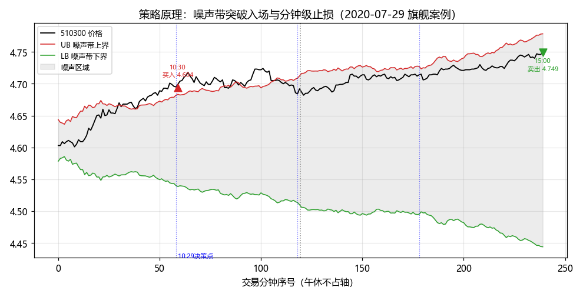
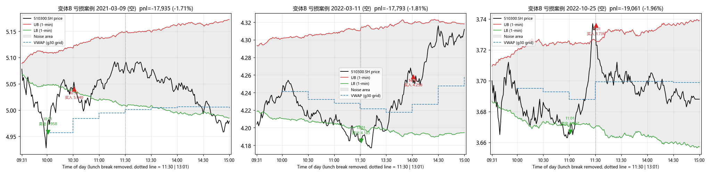
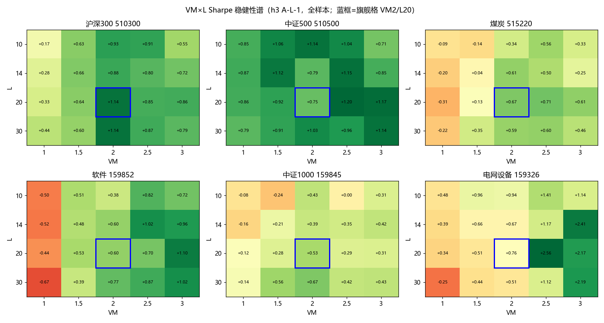
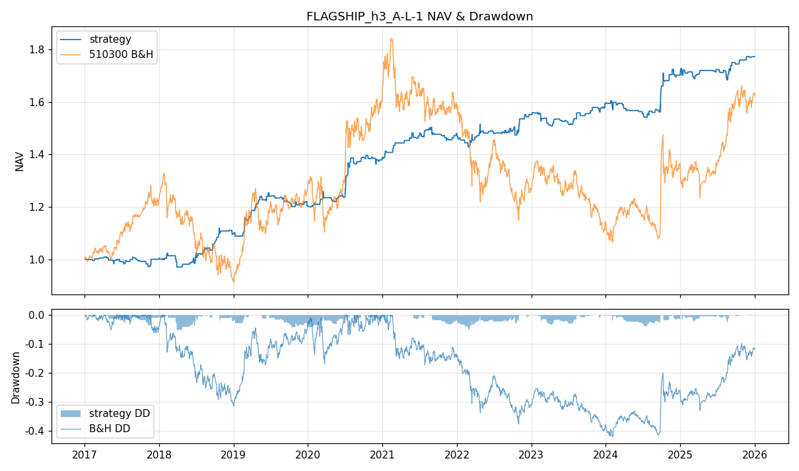
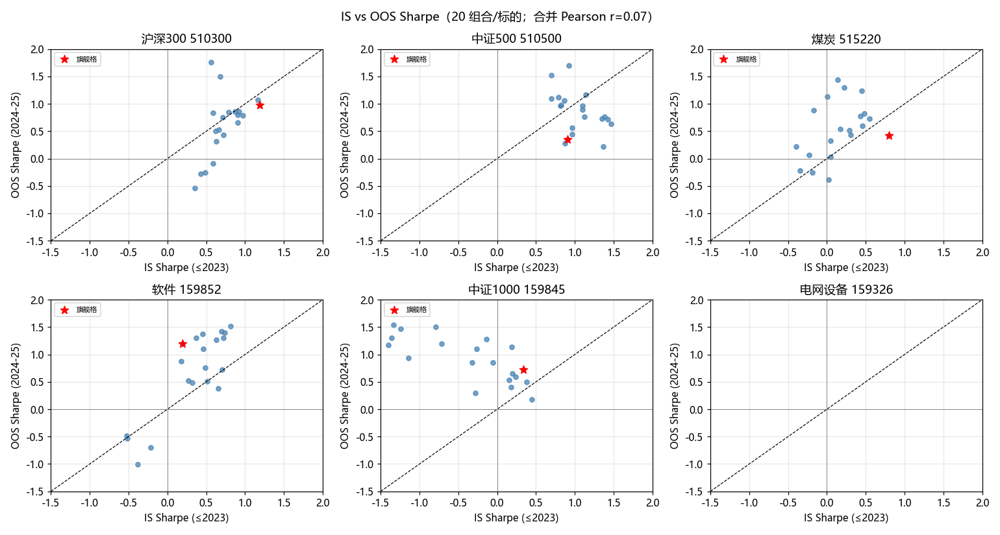
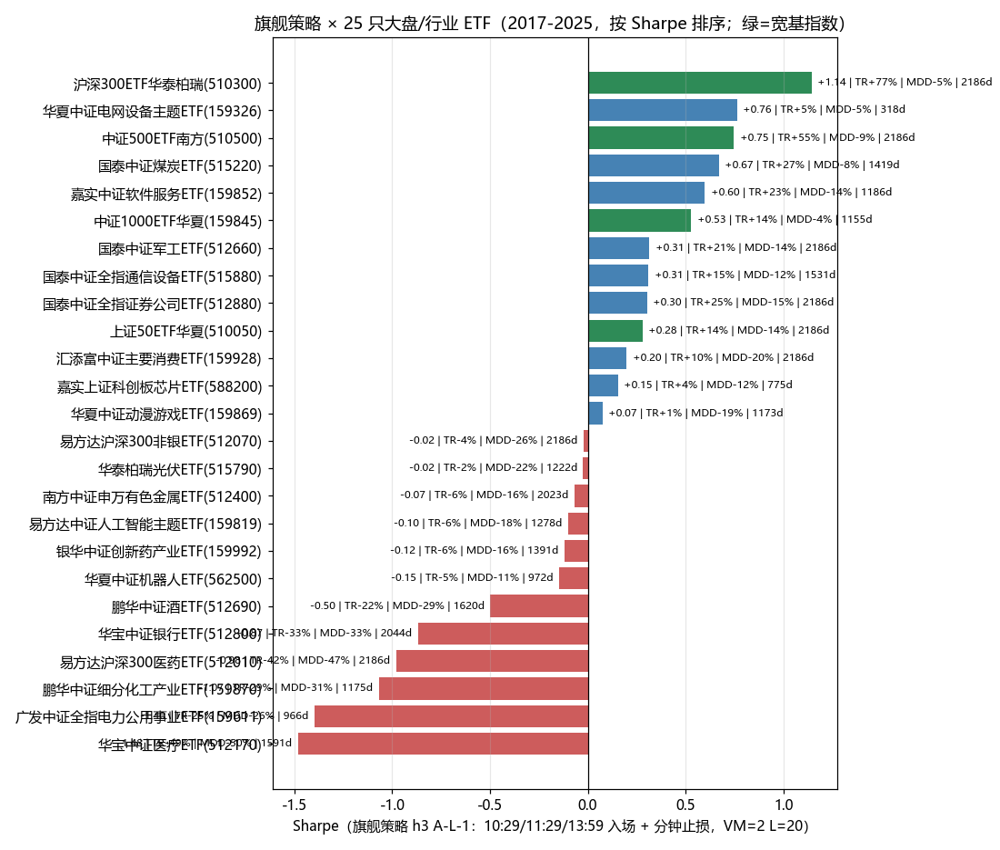
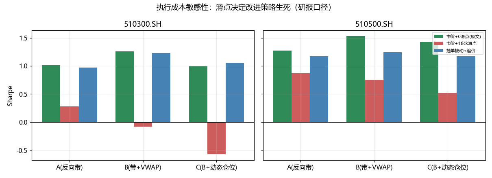
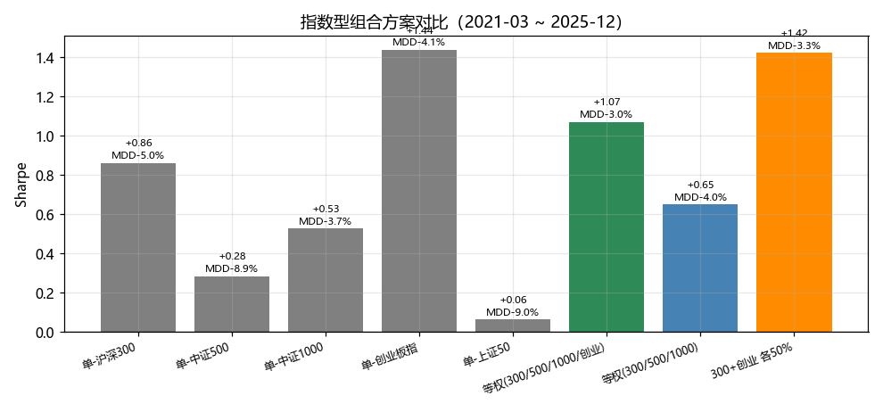

# 研究之路（一）：旗舰策略——从一篇美股论文到一个可上线的 A 股日内动量策略

> 一份按思考顺序展开的研究记录。每一步都回答上一步留下的问题，并给出当时的证据。
> 工程：Intraday_Momentum_for_ETF_strategy ｜ 数据：510300 分钟级，2017-01~2025-12

---

## 第 1 步：问题从哪儿来——美股的印钞机在 A 股还能转吗？

一切的起点是一篇论文：Zarattini 等《Beat the Market: An Effective Intraday Momentum Strategy for S&P500 ETF》。
它的核心思想朴素得诱人：**日内价格在一个"噪声带"内波动是随机的；一旦突破，就是真实的供需失衡，跟随它直到收盘**。
论文在 SPY 上 2007-2024 年显著跑赢买入持有。

我的问题只有一个：**这套逻辑搬到 A 股的沪深300ETF(510300）上，还能赚钱吗？**

图 1 就是策略的全部：灰色区域是噪声带（由过去 14-20 天同一分钟波动的均值构造），
价格突破上界做多、跌破下界做空，当日收盘前强制平仓。

## 第 2 步：先复现，用别人的答案校准自己的引擎

复现最怕"各说各话"。我们的做法是把前序项目（RUN-001）已审阅通过的全流程数值当作**锚点**：
同样的数据冻结、同样的 bar 语义（END 标签）、同样的成交假设（信号=时点 bar 收盘、成交=下一分钟开盘），
新引擎的每一笔成交必须逐值一致。

**结果：19/19 锚点全部通过**（成交笔数 2840/3410/3410、期末资金逐分一致、首笔成交 2017-01-23 10:01 买入 297,600 份 @3.378）。
这一步之后，引擎的正确性不再需要怀疑，后面的每个数字都可信。

## 第 3 步：第一个意外——论文的"增强"在 A 股全是负贡献

论文除了基础策略（A：反向带止损），还有两个增强：B（当前带+VWAP 紧止损）、C(B+波动目标动态仓位）。
复现结果（2017-2025，万1+1tick 成本）：

| 变体 | 总收益 | Sharpe | 结论 |
|---|---|---|---|
| A 基础 | +22.3% | 0.269 | 唯一存活 |
| B 紧止损 | −18.9% | −0.244 | 失效 |
| C 紧止损+动态仓位 | −58.1% | −0.537 | 严重失效 |

为什么？我打开逐笔数据找微观证据（图 2）：变体 B 最亏的几笔全是**空头被 VWAP 紧止损打回**——
早盘跌破下界开空，盘中 V 型反转，价格刚一碰到"VWAP 与带的较紧止损线"就被切在反弹高点。
A 股 510300 日内反转多、趋势延续少，**止损越紧，被噪声收割得越狠**。

动态仓位的问题更隐蔽：它按 σ_target/σ_14日 倒数调仓——低波动期加杠杆，
而 A 股低波动期之后往往接震荡市（策略最怕的行情），**杠杆恰好加在最不该加的时候**。
（后续 σ_target 全谱遍历证实：不是杠杆有害，是"倒数择时"有害；恒定 2 倍杠杆反而可用。)

**当时形成的判断：论文的增强模块不能照搬；要救活这个策略，必须改的是入场时间点与止损方式，而不是仓位。**

## 第 4 步：改造——把决策点挪到"信息沉淀之后"

论文用每半小时检查一次。我尝试了两个方向并做了全谱对比：

1. **决策时间点**：半小时网格 g30/g15/g05 之外，测试"1 小时 K 线"三时点 **10:29 / 11:29 / 13:59**
  （让开盘情绪与午休重定价先走完，再判断趋势）;
2. **止损频率**：决策点检查（论文）vs **每分钟检查**(L-1)。

结论清晰：

- 三时点（h3）显著优于半小时网格——避开了 10:00 与 13:00 两个噪声最重的时刻；
- 分钟止损对"宽松的反向带止损"略有增益，对"VWAP 紧止损"是雪上加霜（进一步坐实第 3 步的判断）;
- **h3 + 分钟止损的 A 变体，是全部组合里最稳的形态**。

## 第 5 步：参数定型——要"平台"，不要"尖点"

剩下两个参数：噪声带乘数 VM 与回看天数 L。遍历 VM×L×三网格（108 组合）后（图 3）：

- VM<1.5 全面差（交易太密、成本吃光）;**VM≥2 是一整片平台**（邻格 Sharpe 0.8~1.14);
- L 影响次要；最优格 VM=2.0/L=20（蓝框）被平台包围——**不是过拟合尖点**。

至此旗舰策略定型：**h3 三时点入场 + 分钟级反向带止损 + VM=2.0/L=20 + 固定 100% 仓位**。

## 第 6 步：旗舰绩效与"它凭什么赚钱"

全样本（2017-2025,2186 日）:**总收益 +77.2%、Sharpe 1.143、最大回撤 −5.2%**、仅 556 个交易日有交易。

机制研究解释了它凭什么赚钱：

- 开仓后不回头的交易（MAE<0.1%）占 16%,**胜率 98%**；一旦下探超 0.35% 期望翻负——盈亏在开仓几分钟内定型，这正是分钟级止损的价值所在；
- 日历效应：周一/周五显著强于周中（周五胜率 57%);
- 胜/败的**方向**不可预测（游程检验不显著），但**波动幅度**高度集聚——大亏大赚都扎推高波动 regime。

## 第 7 步：会不会是运气？——留出验证与参数漂移

两个最直接的质疑，用实验回答（图 4):

- **留出验证**:2017-2023 选参、2024-2025 样本外：旗舰格恰好是样本内最优，OOS Sharpe 0.97（样本内 1.19),MDD 收窄到 −3.9%;
- **参数漂移**：逐年/半年/逐月重校准——逐年调参 ≈ 固定参数（1.175 vs 1.241);**逐月调参显著变差**(0.688，过拟合差距 1.21)。

**结论：参数漂移客观存在（L 在 10↔30 间跳、VM 漂 2.0~3.0)，但漂移主要是追噪声；固定参数 + 每年评审一次，是正确纪律。**

## 第 8 步：这只股票行，别的行不行？——25 只 ETF 的适用性地图

同一旗舰参数扫过 25 只大盘/行业 ETF（图 5):

- **宽基指数整体有效**(300/500/1000 分列前茅），周期高波行业（煤炭/软件/军工/券商）有效；
- **防御行业全面失效**（医药/医疗/电力/化工/银行/白酒）——策略赚的是趋势日的钱，低波品种日内突破后都是反转。
- 结论：上线范围限定**指数型标的**。

## 第 9 步：纸面盈利到账户盈利的最后一公里——执行研究

策略单笔边际利润很薄（中位 ~10bps)，而 510300 一个最小价位就是 2-3bps——**执行成本决定生死**（图 6):

三种口径对照（同一信号）:
- 市价 + 1 tick 滑点：A 的 Sharpe 从 1.08 掉到 0.33,B/C 全灭；
- **挂单（开盘价或让 1 tick）被动成交：≈ 零滑点市价**（穿价成交率 63-66%，含触价半数 ~82%);
- 追价最坏情景也优于付滑点。

**纪律定型：开盘价挂单执行，绝不付市价滑点；实测成交率与冲击成本是上线一票否决项。**

## 第 10 步：从单策略到组合

最后一步是组合化（图 7)。指数型标的中，旗舰在 300 最强、创业/1000/500 均有贡献且相关性仅 0.34~0.55:

（最终混合配置——300 旗舰 + 其余用券商改良版——见系列报告二；纯旗舰视角下，300+创业 50/50 已能做到 Sharpe 1.42、MDD −3.3%。)

## 结论：旗舰策略是什么、凭什么、怎么上

1. **是什么**：噪声带突破的日内趋势跟随——h3 三时点入场、分钟级反向带止损、VM2/L20、固定仓位、日内闭合；
2. **凭什么**：复现锚点 19/19 一致；参数是平台非尖点；留出验证通过；逐年调参不优于固定参数；
3. **怎么上**：只用于指数型标的；开盘价挂单；每年评审一次参数；配成交率与滚动胜率监控带。

---

*系列报告二：《券商改良策略接入研究》——如何把券商研报的改进安全地并入本策略。*
